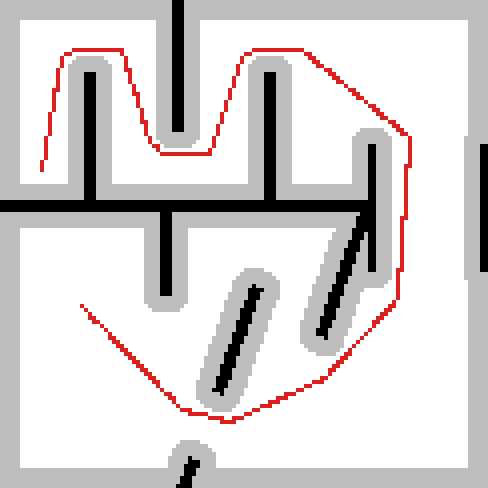
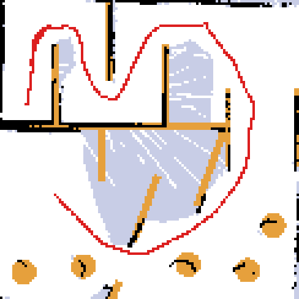

# DroneHacks: Team Long Harrier (drone 007/018) flies the course by itself

Autonomous indoor flight for the DroneHacks course on a Sky Beta drone (Jetson Orin Nano + Pixhawk 6C/PX4,
OAK-D stereo camera, downward rangefinder). The drone takes off from the launch mark, flies the maze, the dark
tunnel and the window, lands and disarms on the pad, then **re-arms by itself and flies back over the walls to
the launch mark**.

> The competition rules and course description that used to be this README are in
> [`README-competition.md`](README-competition.md). Course measurements: [`README-course-dimensions.md`](README-course-dimensions.md).

---

## Best results

All times are from our own flight logs (takeoff to disarm). Official times are read by the referees from video.

| Run (UTC, 2026-11-08) | What it did | Course time (to last waypoint) | Takeoff → disarm on pad | Return |
|---|---|---|---|---|
| **19:58** | **Full course + return to base** | **58.5 s** | **70 s** | Re-armed after 3 s, flew around the ladder at 2.3 m, came down **0.27 m** from the launch point |
| 14:39 | First full autonomous course | 61.8 s | 74.7 s | (return not enabled) |

- Tracking on the course: median **0.02–0.035 m** off the planned path (PX4's own position).
- Speed that works: **0.3 m/s cruise, 0.2 m/s corners**. 0.5 m/s was tried three times and crashed every time:
  see [`drone_tests/flights/2026-11-08_fast_runs_0.5`](drone_tests/flights/2026-11-08_fast_runs_0.5/README.md).

Flight records with the exact route that flew, the logs and plots:
[`14:39`](drone_tests/flights/2026-11-08_1439_course_success/) ·
[`19:58`](drone_tests/flights/2026-11-08_1958_course_and_return/) ·
[`0.5 m/s attempts`](drone_tests/flights/2026-11-08_fast_runs_0.5/)

---

## How we met every point on the field test

The run is scored on 5 checkpoints in order (35 points), speed, the window (+5) and the return (×1.25).

| # | Checkpoint (rules) | How our run clears it | Evidence |
|---|---|---|---|
| 1 | **First corridor**: reach the end of the first corridor | Waypoints 1–2 follow the floor line out of the launch corridor and make the turn | Route built from a hand-carried walk along the floor line; 14:39 and 19:58 logs |
| 2 | **Maze**: leave the maze through Gate A | The top edge (waypoints 2–5) runs along the maze corridor and exits toward the tunnel | Same; the top edge position was tuned after net and wall contacts (see below) |
| 3 | **Tunnel**: come out of the south end of the dark tunnel | The tunnel is one straight leg at **1.0 m** (into the tunnel at the top-right corner, out at the bottom-right) | 19:58: 0.035 m median off the path through the tunnel |
| 4 | **Chicane**: enter the landing area through the **window** | Rises to **1.3 m** and flies straight through the window (sill ~0.9 m) | Window crossing measured on the walk; flown cleanly at 14:39 and 19:58 (**+5 window bonus**) |
| 5 | **Landing**: land and disarm with the whole drone inside the pad's outer ring | Flies level to the pad at 1.15 m, hovers 1 s, comes straight down; PX4 disarms 2 s after touchdown | 19:58: landed and disarmed 0.14 m from the pad waypoint. The scoring ring is 1.52 m across, so the 0.33 m drone has ~0.6 m of slack |
| Rule | **Stay below the walls (68 in = 1.73 m)** on the run | Every course waypoint is 1.00–1.30 m; routes above 1.5 m are refused by the code | Height profile in every flight record |
| Bonus | **Return (rule 7.10)**: after disarming on the pad, take off by itself, fly back over the barrier, land within 2 ft (0.61 m) of the launch mark, within 3 min | Waits 3 s, sends one Offboard + one ARM command, climbs **straight up to 2.3 m**, flies **around the ladder** (pad → R1 → R2 → over the launch mark), comes **straight down**, lands 15 cm to the right of the mark (away from the net) | 19:58: re-armed and flew the return; came down 0.27 m from the launch point. Whole run ~2 min, inside the 3 min limit |

---

## Our approach

### 1. How the drone knows where it is: camera for x/y, rangefinder for height, fused in PX4

There is no GPS indoors (and the rules forbid it), so position comes from two sensors, combined by PX4's EKF2:

```
OAK-D stereo (mono 1024x640, ~30 fps) --> cuVSLAM visual odometry (camera only, IMU fusion off, ~30 Hz)
        --> organizers' bridge --> /fmu/in/vehicle_visual_odometry --> PX4 EKF2: horizontal position (x, y) + heading
downward rangefinder (+ barometer backup) -------------------------------> PX4 EKF2: height
PX4 EKF2 --> /fmu/out/vehicle_local_position --> our route follower (every target and every "arrived" check)
```

- **x / y and heading come from the camera (VIO).** The drone's horizontal position is the camera's visual
  odometry, fused by PX4 (`EKF2_EV_CTRL = 9`: vision horizontal position + yaw, vision height off).
- **Height comes from the rangefinder** (`EKF2_HGT_REF = 2`, barometer as backup), never from the camera.
- **Our code reads only PX4's fused position** (`vehicle_local_position`). It never reads the camera directly,
  and it relays PX4's position to the organizers' `flight_interface` so the height limits are measured the same way.

Why it's split like this:
- Our first autonomous attempts (the organizers' example) **climbed into the net**: the example took its height from
  the camera tracking, which disagreed with PX4's rangefinder height, so it kept commanding "up".
- The camera's own height drifted badly (drone 7 climbed toward the ceiling on a 26 m VIO height error).
- **Depth mode was turned off**: computing stereo depth on the drone made the visual odometry ~300 ms late, so EKF2
  rejected it. **Recording camera images during flight** delayed it by 170–340 ms and made PX4's position jump, so
  our capture script records only PX4 and odometry topics.
- How good it is: on the 19:58 run PX4's position kept the drone a median **0.035 m** from the planned line,
  including in the dark tunnel; at 0.5 m/s it still held 0.03–0.11 m.

### 2. A small waypoint follower: `team_src/px4_route`

- Waypoints are written as `[forward, left, up]` in metres **from the takeoff point**, so the route works wherever
  the drone is placed (we place it ~4 in behind the X, nose toward the pipe wall).
- A **"carrot"** target slides along the path at the planned speed, but only while the drone keeps up. The drone
  follows the line instead of cutting corners. It slows to the corner speed near every turn and at the end.
- **Nose forward** (`yaw: path`): the camera always looks where the drone is going. At corners it turns in place
  first (within 20°) and turns at most 30°/s.
- The only thing that talks to PX4 is the organizers' `flight_interface` (it clamps every target to a height band).
- **Safety:** routes above 1.5 m (2.4 m for the return) or with bad numbers are refused before flight; any internal
  error lands straight down; the node only takes over on a fresh Altitude → arm → Position sequence; every flight
  writes a 10 Hz CSV and an event log.
- 25 unit tests and a **mission simulator** (fake PX4 with arming, landing detection and auto-disarm) that runs
  the real node code through course → pad → disarm → re-arm → return → disarm before anything is flown.

### 3. The route came from walking the course

We carried the running drone along the course's floor line and recorded PX4's position and the rangefinder
(`drone_tests/walks/walk-20261107-215520`). That walk gave the waypoints and the heights: 1.0 m in the tunnel,
1.3 m at the window (the rangefinder saw the sill at ~0.9 m). The CAD model was only used for rough overlays: its
window and chicane do not match the built course.

### 4. Then we fixed it from real flights

| Problem seen | Fix |
|---|---|
| Climbed into the net (organizers' example) | Own follower on PX4 position |
| Top edge at 1.41 m forward hit the net (12:29, 12:36) | Top edge moved to 0.65–0.67 m |
| Rclpy logging bug killed the node in the air | One log severity per call site + crash-proof loop that lands on any error |
| A new flight could start from leftover Offboard | Takeoff only on a fresh Offboard switch |
| Landed 35 cm off the pad centre | Pad waypoint corrected from an overhead photo (drone size as the ruler) |
| Ladder stands over the straight return line | Return routed around it at 2.3 m |
| Return landing close to the net | Return lands 15 cm right of the launch mark |
| Rear props touched a wall on the top edge at 0.5 m/s | Speed back to 0.3 (an extra waypoint further from that wall was tried, but only flown at 0.5) |

### 5. Speed

| Speed / corners | Result |
|---|---|
| **0.3 / 0.2** | **Completed the course (14:39) and the course + return (19:58)** |
| 0.5 / 0.3 | Hit the wall on the top edge (20:05); hit something after the tunnel exit (23:37) |
| 0.5 / 0.2 | Hit something right after takeoff (23:44) |

Camera tracking held 0.03–0.11 m at 0.5 m/s, so localization was not the limit. The course has only a few
centimetres of margin on the top edge and at the tunnel exit, and the drone swings ~13 cm wider at corners at
0.5 m/s. Details: [`drone_tests/flights/2026-11-08_fast_runs_0.5`](drone_tests/flights/2026-11-08_fast_runs_0.5/README.md).

---

## Also built: computer vision and planning (bench and simulation, not flown)

The flown stack is a fixed route on PX4's position. In parallel the team built perception and planning that would
let the drone find its own way. None of it was integrated into a flight; it was tested on recorded data and in
simulation.

### Landing-pad detector (YOLOv8n): [`team_project/cv/pad_detector_yolo`](team_project/cv/pad_detector_yolo)

A one-class (`pad`) **YOLOv8n** detector trained from phone videos of the pad: hand-label a baseline, train, let the
model pre-label the rest while a person corrects it, retrain, then test on a video it never saw (scripts `01_` to `07_`).

| Model | Epochs | Precision | Recall | mAP50 | mAP50-95 |
|---|---|---|---|---|---|
| Colour | 100 | 0.993 | 0.875 | 0.875 | **0.775** |
| Grayscale (like the OAK's mono cameras) | 50 | 0.993 | 0.875 | 0.875 | 0.741 |

### Stereo-depth hazard bench: [`team_project/cv/hazard_depth`](team_project/cv/hazard_depth)

The question: **"would flying straight hit something in the next 2 m?"** A hand-carried OAK stereo walk through the
course was cut into a fixed 400-frame test set, each frame hand-labelled blocked/clear against a drone-sized tube
(0.6 × 0.25 × 2 m). Algorithms that run on a Jetson CPU (OpenCV + NumPy) were scored on it:

| Algorithm | Balanced accuracy (chance 0.333) | Correlation with the turns actually taken | Depth coverage |
|---|---|---|---|
| StereoBM 320×200 | 0.400 | 0.18 | 0.62 |
| **StereoSGBM 320×200** | 0.388 | **0.25** | 0.77 |
| Optical-flow nearness (mono) | 0.380 | 0.15 | 1.00 |

Result: stereo depth on this course is only weakly predictive (best correlation 0.25), and turning depth on in the
drone's camera pipeline delayed the visual odometry (see section 1). That is why the flown stack uses a fixed route.

### Theta\* planner with frontier exploration: [`planner/`](planner)

The drone starts with **no map**: each frame it turns depth readings and its pose into an occupancy grid, picks a
goal at the edge of known space (or the pad once seen), plans an any-angle path with **Theta\*** (with a clearance
cost), and follows it, backing off and re-planning if it gets stuck. Simulated only (depth and drift are simulated).

Runs from 2026-11-08 (`python run_course_test.py`, `python run_closed_loop.py 3`):

| Test | Result |
|---|---|
| Perfect map, launch → pad | 16 waypoints, 15.1 m, min clearance 0.28 m, planned in 0.4 s |
| Same, window blocked (forced through Gate B) | 21 waypoints, 15.7 m, min clearance 0.28 m |
| Closed loop, seed 0 (map built while flying) | landed, through the window, 0 touches, 53.8 s, drift 0.14 m |
| Closed loop, seed 1 | landed, through the window, 0 touches, 56.2 s, drift 0.31 m |
| Closed loop, seed 2 | landed, through the window, **1 touch** near the window, 58.1 s with penalty |

<p align="center">
  
  
  <br><sub>Left: Theta* on the perfect map (red path, grey = clearance margin). Right: a simulated flight that built
  its own map (black = walls it saw, orange = walls it never saw, red = path flown)</sub>
</p>

Known limits (from the planner README): it fails ~1 flight in 6 at 4× the assumed drift, the 0.76 m flight height is
fixed, and the depth noise numbers are guesses until measured on the drone.

### Other simulation and integration work (archived)

- **FlyX simulator waypoint runs with a scan matcher** (depth matched against the course walls):
  [`archive/sim-waypoint-run`](https://github.com/yashashaw/Dronehacks/tree/archive/sim-waypoint-run). Best version
  flew the full route through the window (at 0.76 m) and landed on the pad, 0.04 m from its centre by its own
  estimate; it was graded fail only on wall clearance (0.25 m against a 0.28 m limit).
- **Integration of the pad detector, a depth planner and the localization stack** into ROS packages
  (`course_pipeline`, `team_planner`, `loc_stack`): [`archive/integration`](https://github.com/yashashaw/Dronehacks/tree/archive/integration). Not flown.

---

## Repository map

| Path | What |
|---|---|
| `team_src/px4_route/` | **The flight code**: route follower node, launch file, route files, tests, mission simulator |
| `team_src/px4_route/routes/course_v2_return.yaml` | **The route that flew the course + return at 19:58** (9 waypoints, 0.3 / 0.2) |
| `team_src/px4_route/routes/course_v2.yaml` | Same course without the return |
| `team_src/px4_route/routes/return_to_x.yaml` | The return to base |
| `drone_tests/` | Capture and status scripts, the course walk, flight records |
| `planner/` | Theta* planner with frontier exploration (simulation only, never flown) |
| `docs/planner_sim/` | Pictures from the planner simulation runs shown above |
| `team_project/` | Team index: the workspace at 14:39, the CV work (YOLOv8n pad detector, stereo hazard bench), branch summaries |

## Flying it

1. Copy the route to the drone as `~/team_ws/routes/route.yaml` (and `return_to_x.yaml` next to it), restart the
   stack with the drone on the ground and disarmed: `docker rm -f skybeta-stack`.
2. Place the drone ~4 in behind the X, nose toward the pipe wall. Power-cycle and leave it still while it boots.
3. Check: `~/team_ws/drone_tests/dt.sh status` and the competitor window must show `route "course-v2-return"`,
   `RETURN ENABLED` and `relaying PX4 position`.
4. Transmitter: **Altitude → arm → Position**. Stay clear after it lands on the pad: it re-arms by itself ~5 s later.
   Flip the mode switch off Position on the pad to cancel the return. Kill switch at any time.
