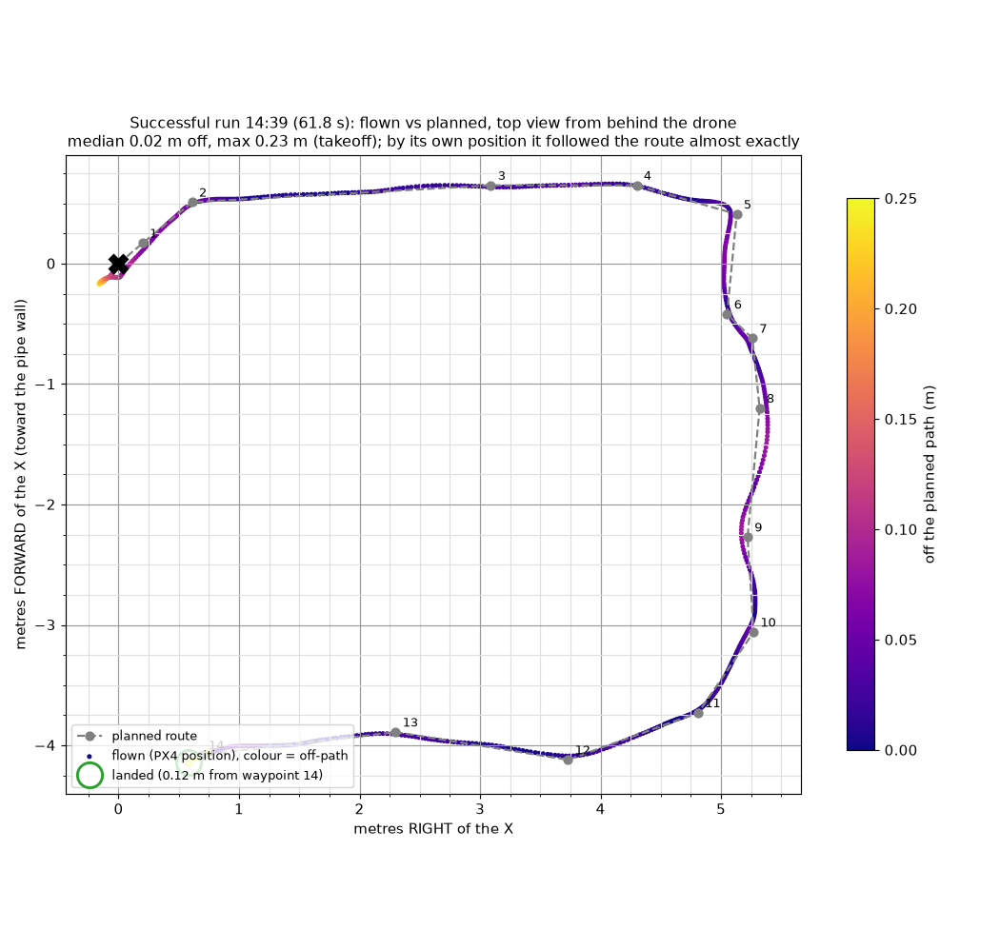
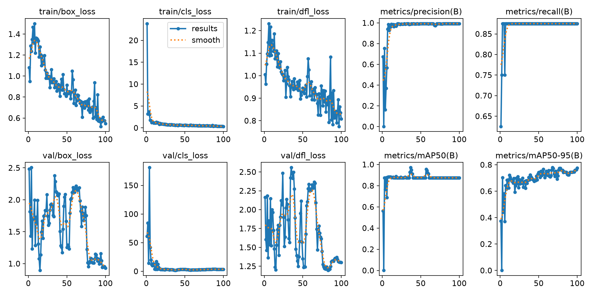
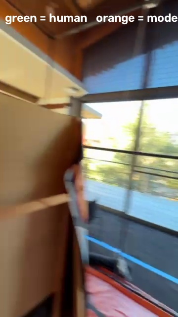
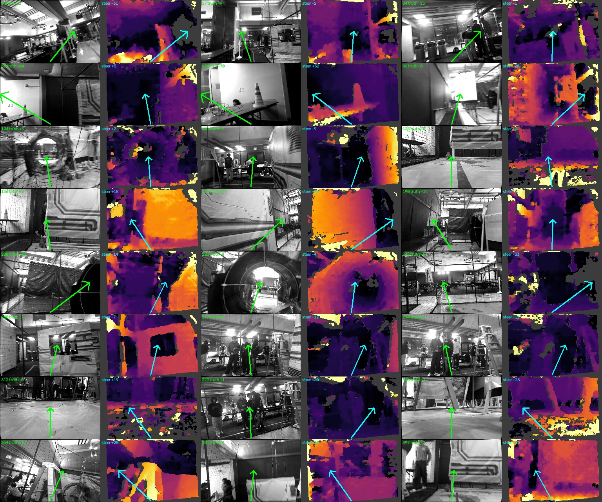
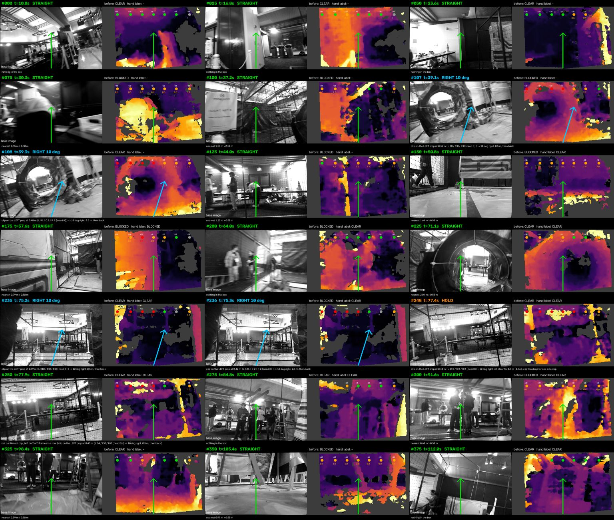

<div align="center">

# 🛩️ Team Project: Sky Beta, Drone 18

**DroneHacks 2026: one folder that points to everything the team built**

`team_ws/` is what flew &nbsp;·&nbsp; `cv/` holds the vision runs &nbsp;·&nbsp; every other branch is summarized below

</div>

---

## At a glance

| | |
|---|---|
| 🏁 **First autonomous course run** | Drone 18, 2026-11-08 14:39 (PX4 clock). It flew the full 15 m course in **61.8 s** and landed and disarmed by itself **0.12 m from the pad** |
| 🎯 **Tracking** | Median **0.02 m** off the planned path; max 0.09 m after takeoff (from PX4's own position) |
| 🧭 **How it flies** | Position and height come from PX4 only. VIO feeds EKF2 horizontally, and there is no depth mode. There is one `flight_interface`. The pilot arms in Altitude and then switches to Position |
| 👁️ **Vision** | A YOLOv8n landing-pad detector (precision 0.99, mAP50 0.875) and a stereo-depth hazard bench scored on 400 hand-labelled frames |

<p align="center">
  
  <br><sub>14:39 run: flown path (PX4 position) vs planned path</sub>
</p>

---

## 1. `team_ws/`: the workspace that flew

This folder mirrors **`~/team_ws` on drone 18** at the time of the 14:39 run. It was taken byte-for-byte
from commit [`79b5383`](https://github.com/yashashaw/Dronehacks/tree/79b5383) on `try-course-1`, which
is the commit that recorded that flight (*"Flown code and route, exactly as on the drone"*).

> ⚠️ **Rebuilt from the commit, not copied off the drone.** The drone was unreachable when this folder was
> made, so nothing here has been compared against the board.

```
team_ws/
├── src/                     ← colcon builds this at boot (a broken package here = no takeover)
│   ├── px4_route/           ← the boot package that flew: COMPETITOR_PKG=px4_route
│   └── px4_square/          ← the earlier PX4-only square it grew from (also installed by --boot)
├── routes/
│   └── route.yaml           ← the course route that flew (= flights/…/route_flown.yaml)
└── drone_tests/             ← outside src/ (COLCON_IGNORE): install, status, recording, flight records
    ├── install.sh  dt.sh  bg.sh  hover.py  stereo_video.sh  depth_motors.py …
    ├── walks/walk-20261107-215520/     ← hand-carried course walk the route was made from
    └── flights/2026-11-08_1439_course_success/   ← CSV (10 Hz), event log, plot
```

| Piece | What it does |
|---|---|
| [`src/px4_route`](team_ws/src/px4_route) | Course route follower. A "carrot" setpoint slides along the path at the planned speed and slows for turns. The nose faces along the path and turns before moving. It lands straight down if the drone goes too far off the path, too high, has stale PX4 position, or runs out of time. It has unit tests and a fake-PX4 sim ([`tools/sim_mission.py`](team_ws/src/px4_route/tools/sim_mission.py)) |
| [`src/px4_route/launch`](team_ws/src/px4_route/launch/px4_route.launch.py) | The **one** `flight_interface` (`anchor_setpoints: false`, altitude band from PX4) plus the route node. It reads `/root/team_ws/routes/route.yaml` |
| [`src/px4_square`](team_ws/src/px4_square) | The first clean PX4-only flight (PX4 log 26). `px4_route` uses the same setup |
| [`drone_tests/`](team_ws/drone_tests) | The ground-up test kit for drone 18: props-off depth→motor test, stereo video capture, background PX4 recorder, status checks |
| [`drone_tests/flights/…1439…`](team_ws/drone_tests/flights/2026-11-08_1439_course_success) | Flight record: `route-20261108-143920.csv` / `.log`, the route flown, and notes for the next runs |

**Boot config** (`/etc/skybeta/drone.env`): `COMPETITOR_PKG=px4_route`, `COMPETITOR_LAUNCH=px4_route.launch.py`.
Full instructions are in [`src/px4_route/README.md`](team_ws/src/px4_route/README.md) and [`drone_tests/README.md`](team_ws/drone_tests/README.md).

---

## 2. `cv/`: the computer-vision runs

### 2a. [`cv/pad_detector_yolo/`](cv/pad_detector_yolo): landing-pad detector

A one-class (`pad`) **YOLOv8n** model trained from phone videos. The steps were: hand-label a small baseline, train,
let the model pre-label the remaining frames while a person corrects them, retrain, then check it on an unseen video.
The scripts are numbered `01_…` → `07_…`.

| Run | Images (train/val) | Epochs | Precision | Recall | mAP50 | mAP50-95 |
|---|---|---|---|---|---|---|
| `video_training/runs/final` (colour) | 201 / 51 | 100 | 0.993 | 0.875 | 0.875 | **0.775** |
| `video_training_grayscale/runs/final` (mono, like the OAK) | same | 50 | 0.993 | 0.875 | 0.875 | 0.741 |

<p align="center">
  <br>
  
  <br><sub>Training curves (colour, final run) · held-out video IMG_6184. The full clip is in <a href="cv/pad_detector_yolo/video_training/results/IMG_6184_inference.mp4"><code>results/IMG_6184_inference.mp4</code></a></sub>
</p>

Included: scripts, READMEs, every run's curves/CSVs/args, `models/final.pt`, and the held-out comparison frames and video.
**Kept on the branch** (too big for an index): raw `.mov` videos, the labelled datasets, `yolov8n.pt` and the 32 MB grayscale weights.
See [`CV_experiments/CV`](https://github.com/yashashaw/Dronehacks/tree/CV_experiments/CV).

### 2b. [`cv/hazard_depth/`](cv/hazard_depth): stereo-depth hazard bench

The question was **"would flying straight hit something in the next 2 m?"** It was answered on a hand-carried OAK
stereo walk through the course (1024×640 mono, 30 fps). The walk was cut into a fixed **400-frame test set**, and every
frame was hand-labelled blocked/clear against a 3-D drone-sized tube (0.6 × 0.25 × 2 m). The bench is light enough for
a Jetson: it needs only Python 3.6 + OpenCV + NumPy and no GPU.

| Algorithm (400 frames) | Balanced acc. (chance .333) | Spearman vs turn | Coverage | Notes |
|---|---|---|---|---|
| StraightAhead | 0.333 | 0 | – | floor |
| StereoBM 320×200 | 0.400 | 0.18 | 0.62 | speckle blocks every frame |
| **StereoSGBM 320×200** | 0.388 | **0.25** | 0.77 | the only correlation that clearly excludes 0 |
| FlowNearness (mono) | 0.380 | 0.15 | 1.00 | no model |
| CenterThenRight (team rule, `open_m` 2.0) | 0.401 | 0.05 | 0.77 | best straight recall 0.92 |

**Flight-rule check (`dodge_diag`).** The flight code's own prop-clip rule (sidestep only when something is within
0.5 m in one prop zone) was run on every frame. Results: **STRAIGHT 395 / RIGHT 4 / HOLD 1** of 400, and
189/192 hand-labelled clear frames stayed straight. A second set (`depth_set_v2`, 366 frames from 0:30–2:00) gave 360 / 3 / 3.

<p align="center">
  <br>
  
  <br><sub>StereoSGBM depth sheet · per-frame flight-rule decisions</sub>
</p>

Included: all bench code (`depthsuite/`, `testsuite/`, `tests/`), the hand labels, and for every algorithm its
`report.json` (with 95 % CIs), `per_sample.csv` and contact sheet. The per-frame images and raw stereo frames
(~2 GB) stayed on the laptop that made them. Full write-up: [`cv/hazard_depth/README.md`](cv/hazard_depth/README.md).

---

## 3. Everything else, by branch

| Branch | What's there | Flew? |
|---|---|---|
| **`main`** (here) | Organizer docs ([`README.md`](../README.md), [`AI_CONTEXT.md`](../AI_CONTEXT.md)), course model (`.glb/.obj/.step`), [`dronehacks-starter/`](../dronehacks-starter), [`planner/`](../planner) (Theta\* + frontier exploration, tested in sim), [`autonomy_pipeline_md.md`](../autonomy_pipeline_md.md), [`square_mission_instructions.md`](../square_mission_instructions.md), [`ssh_instructions.md`](../ssh_instructions.md), OAK-D mount [`oak-d-camera-mount.stl`](../oak-d-camera-mount.stl) | – |
| `try-course-1` (merged into main: [`team_src/`](../team_src), [`drone_tests/`](../drone_tests)) | Source of `team_ws/` above: `px4_route`, `px4_square`, `drone_tests`, the 14:39 flight record | ✅ **course run** |
| `drone-tests` (merged into main: [`drone_tests/`](../drone_tests)) | Drone 18 test kit built one test at a time: props-off depth→motor spin, stereo video, the 21:55 course walk (VIO + PX4 CSVs) | ✅ PX4 square |
| [`CV_experiments`](https://github.com/yashashaw/Dronehacks/tree/CV_experiments) | Full pad-YOLO pipeline with raw videos + datasets; [`data_collection_walk/`](https://github.com/yashashaw/Dronehacks/tree/CV_experiments/data_collection_walk) (one-Enter bag recording of a hand-carried pass: cameras, IMU, cuVSLAM, PX4) | – |
| [`archive/integration`](https://github.com/yashashaw/Dronehacks/tree/archive/integration) | Three people's work combined: `course_pipeline` (pad detector + guide), `team_planner` (depth planner, 3 modes), `loc_stack`; [`INTEGRATION_STATUS.md`](https://github.com/yashashaw/Dronehacks/blob/archive/integration/INTEGRATION_STATUS.md) | ❌ not flown |
| [`archive/pad-pipeline`](https://github.com/yashashaw/Dronehacks/tree/archive/pad-pipeline) | `course_pipeline` on its own: YOLO pad detection → pad guide → `/skybeta/setpoint/pose`, with `CONTRACT.md` | ❌ not flown |
| [`archive/slam-one-shot`](https://github.com/yashashaw/Dronehacks/tree/archive/slam-one-shot) | `loc_stack/`: localisation health node, preflight checks, walk drift analysis, EKF comparison, depth sweeps, [`CAMERA_ISSUES.md`](https://github.com/yashashaw/Dronehacks/blob/archive/slam-one-shot/loc_stack/CAMERA_ISSUES.md) (depth latency, XLink ceiling, USB link drops) | ground only |
| [`archive/drone-field-tests`](https://github.com/yashashaw/Dronehacks/tree/archive/drone-field-tests) | Drone 7 config: `drone.env`, autostart, camera switches, camera configs, depth sweep variants, [`F1_CLIMB_INCIDENT.md`](https://github.com/yashashaw/Dronehacks/blob/archive/drone-field-tests/team_ws/F1_CLIMB_INCIDENT.md) | drone 7 |
| [`archive/jetson-flight-test`](https://github.com/yashashaw/Dronehacks/tree/archive/jetson-flight-test) | Drone 7 `team_flight_test` + `team_takeoff_land` packages, flight analysis script | drone 7 |
| [`archive/baseproject`](https://github.com/yashashaw/Dronehacks/tree/archive/baseproject) | Organizer `skybeta/` stack docs (competitor guide, debugging, hardware checklist) + drone 7 hardware facts (camera, mount, latency, compute, PX4 limits) | – |

### Lessons that shaped the flown stack
- **No VIO height and no depth mode.** VIO's absolute height sent drones high: drone 7 climbed toward the ceiling from a 26 m VIO height error. Depth mode made vision about 300 ms late, so EKF2 ignored it. All flight height now comes from PX4.
- **One `flight_interface`, never `/fmu/in/*`.** Team code only publishes `/skybeta/setpoint/*`. The pilot arms in Altitude, then switches to Position, which hands over to Offboard.
- **VIO stalls.** Latency spikes of 250–370 ms can make EKF2 drop vision yaw and fall back to the compass, so the heading jumps about 38°. That is under investigation and is why obstacle-avoidance work has stayed on the ground.
- **Power.** One earlier attempt stopped logging mid-air, so check the Jetson power lead and battery connector before every run.
